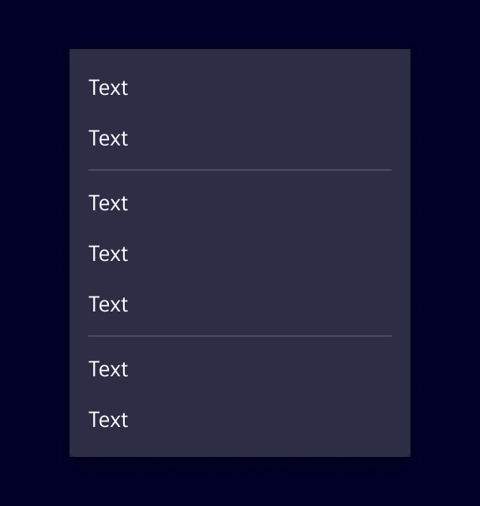
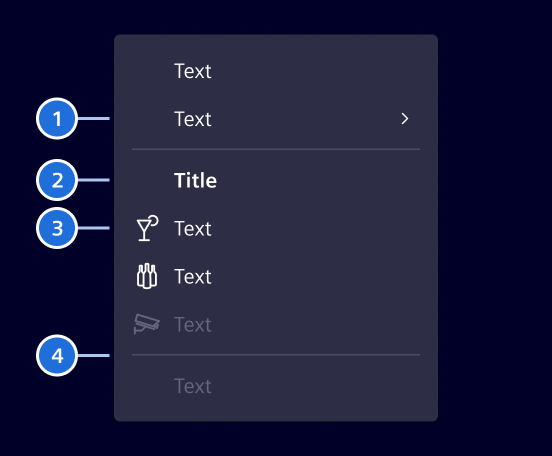
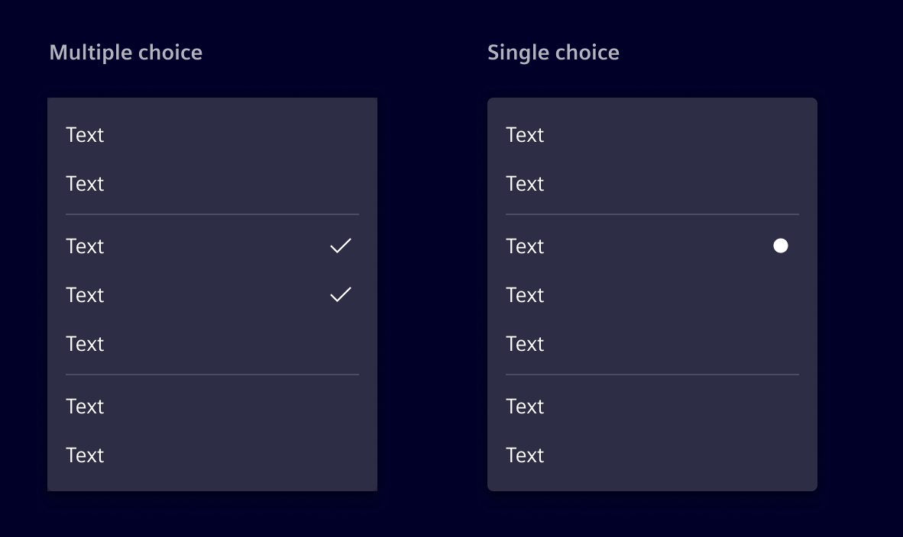

# Menu

**Menus** display a list of actions related to a specific element or context.

## Usage ---

Menus open from a trigger, such as a buttons or right-click,
and show actions related to the current context.

### When to use

- When users need to perform several actions on the same content.
- For actions that are not used frequently and don't need to be permanently visible.
- To keep the interface clean by grouping secondary actions in one place.
- If there is one action only, use [button](buttons.md) or [link](links.md) instead

### Best practices

- Order actions by importance, with the most relevant ones at the top.
- Group related actions and separate the groups with dividers.
- Move less important actions to a submenu.
- Keep disabled actions visible so users know the action exists but is currently unavailable.
- Avoid more than two levels of nested submenus.

## Design ---

### Elements

> 1\. Item with submenu, 2. Section title, 3. Item with icon, 4. Divider

### Selection

Menus can include selectable items with single choice or multiple choice.

- Use single choice when only one option can be active at a time.
- Use multiple choice when users can enable or disable several options independently.

## Code ---

!!! warning "Important API changes"

    With Element v45, the `si-menu` has been completely re-implemented to feature a declarative API style based on the [CDK Menu](https://material.angular.io/cdk/menu/overview).
    If you are migrating from the old `si-menu-legacy`, you might want to consider using the `si-menu-factory`, which provides a more compatible model-driven API.

The `si-menu` has a declarative API and an additional `si-menu-factory` which accepts `MenuItem[]`.
It is built around the [CDK Menu](https://material.angular.io/cdk/menu/overview) using Angular's `hostDirective` feature.
Due to this:

- `CdkMenuTrigger` is required to open the menu
- `CdkMenuItem` can be used directly if proper styling is applied (helpful for special use cases)

### Usage of the declarative API

<si-docs-component example="si-menu/si-menu" height="600"></si-docs-component>

### Usage of the factory API

<si-docs-component example="si-menu/si-menu-factory" height="600"></si-docs-component>

### `si-menu-bar`

The `si-menu-bar` is a horizontal menu that is based on the `CdkMenuBar`.

While being visually similar to the `si-content-action-bar` it has two differences:

- `si-menu-bar` has a declarative API
- `si-menu-bar` has no responsive behavior

In general, we recommend using the `si-content-action-bar` over the `si-menu-bar`.

<si-docs-component example="si-menu/si-menu-bar" height="500"></si-docs-component>

<si-docs-api component="SiMenuItemComponent"></si-docs-api>

<si-docs-api component="SiMenuItemCheckboxComponent"></si-docs-api>

<si-docs-api component="SiMenuItemRadioComponent"></si-docs-api>

<si-docs-api component="SiMenuFactoryComponent"></si-docs-api>

<si-docs-api directive="CdkMenuTrigger"></si-docs-api>

<si-docs-api directive="CdkContextMenuTrigger"></si-docs-api>

<si-docs-types></si-docs-types>
