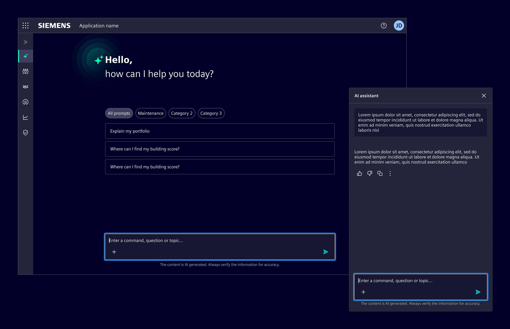
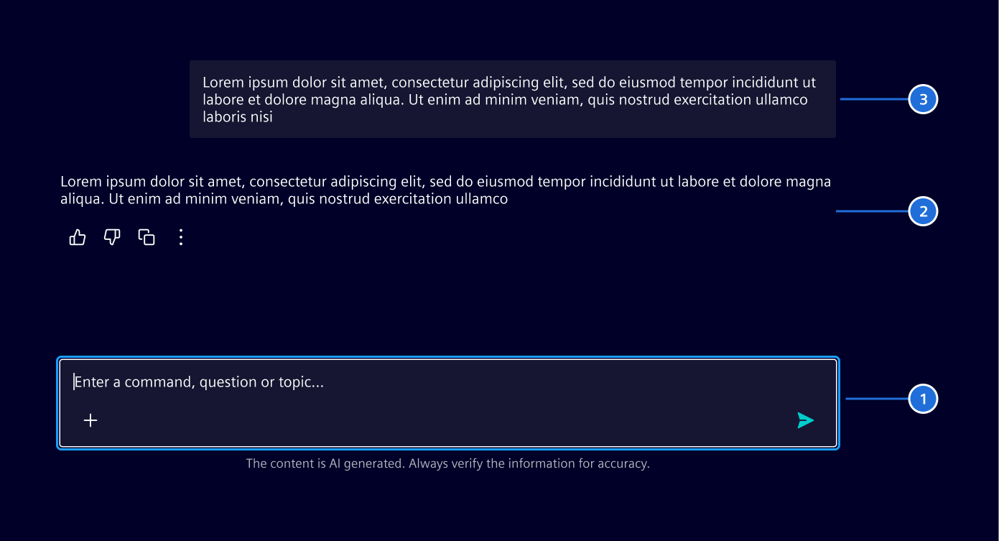
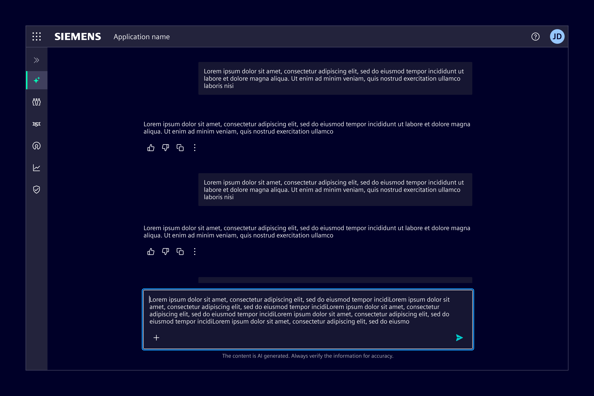
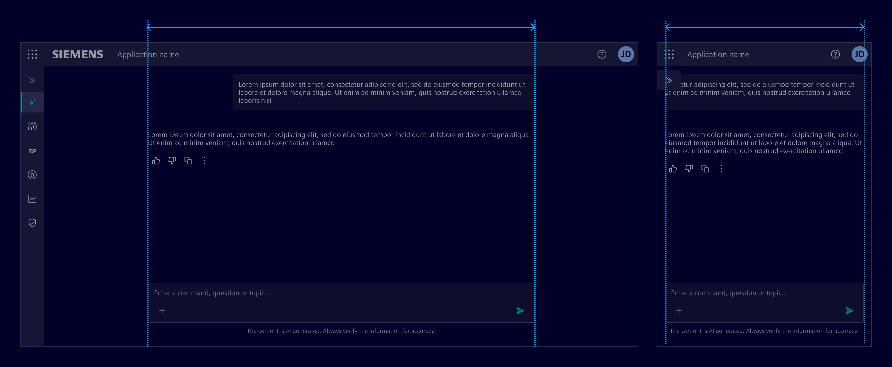
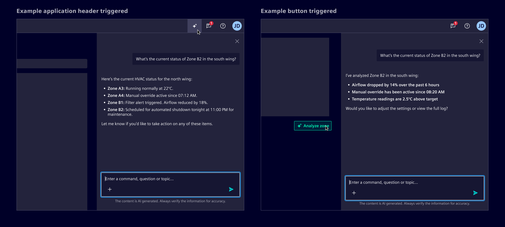
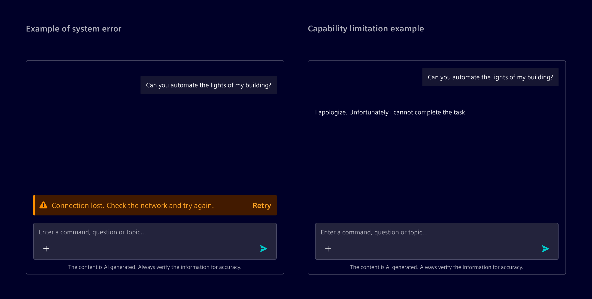
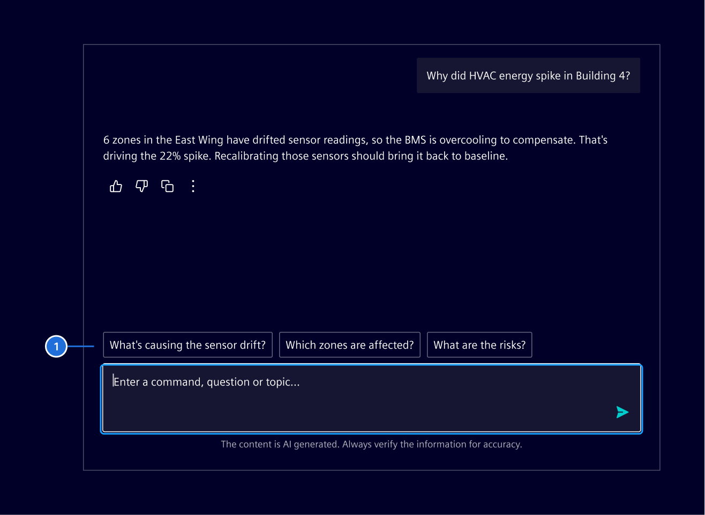

# AI chat container

The **AI chat container** is the frame for any conversation with AI.
It manages the message area, the input, and the states around them.

## Usage ---

The AI chat container arranges the [chat input](../chat-messages/chat-input.md), [chat messages](../chat-messages/), and [AI welcome screen](../chat-messages/ai-welcome-screen.md) into a single
conversational space and handles the logic that connects them.

### When to use

- For AI features where users describe tasks in their own words and expect structured responses or guidance.
- For tasks that are complex, open-ended, or benefit from iteration.
- When natural language input improves the experience compared
  to navigating multiple UI elements.

### Best practices

- Refer to [conversational design](https://ix.siemens.io/docs/guidelines/conversational-design/getting-started) guidelines.
- Always allow users to review, edit, or retry.
- Keep the conversation focused, avoid unnecessary messages.
- Place the AI in a clearly defined visual space.
- Output can be styled as needed using the [typography system](../../fundamentals/typography.md).
- Use [follow-up prompts](../../components/chat-messages/chat-input.md#follow-up-prompts) after AI responses to help users continue the conversation without formulating the next message from scratch.

## Design ---

### Elements

1. [Chat input](../../components/chat-messages/chat-input.md)
2. [Chat message - AI](../../components/chat-messages/chat-message.md)
3. [Chat message - User](../../components/chat-messages/chat-message.md)

### Layouts

#### Full page layout

Use it when AI is the main feature.
Typically triggered from a dedicated navigation item, this layout makes AI functionality easily accessible as a primary experience.

The chat content area has a maximum width of 720px.
It scales fluidly on smaller screens and remains centered on larger ones to maintain readability and visual balance.

#### Side panel layout

Use it when AI supports tasks within the current view.
In this case, the AI appears as an on-demand assistant without disrupting the workflow in a
[side panel](../../components/layout-navigation/side-panel.md).

- When the AI feature is globally accessible, the side panel can be triggered from the
  [application header](../../components/layout-navigation/application-header.md), ensuring consistent entry across all screens.
- For contextual use, place the trigger near the related feature or content.

### Errors and AI limitations

System errors, such as timeouts or backend crashes, occur outside the AI’s reasoning.
These should be represented with [inline notifications](../../components/status-notifications/inline-notification.md),
placed above the input prompt.

When the AI cannot complete a task due to a known limitation, it should respond within the conversation.
These are not treated as errors and do not require a separate notification.

### Follow-up prompts

Follow-up prompts are 2-4 suggested actions based on the AI’s last response.
They guide users toward deeper or related questions.

Show follow-up prompts only after relevant AI responses,
and clear them as soon as the user sends a new message.

> 1. Follow-up prompts

## Code ---
