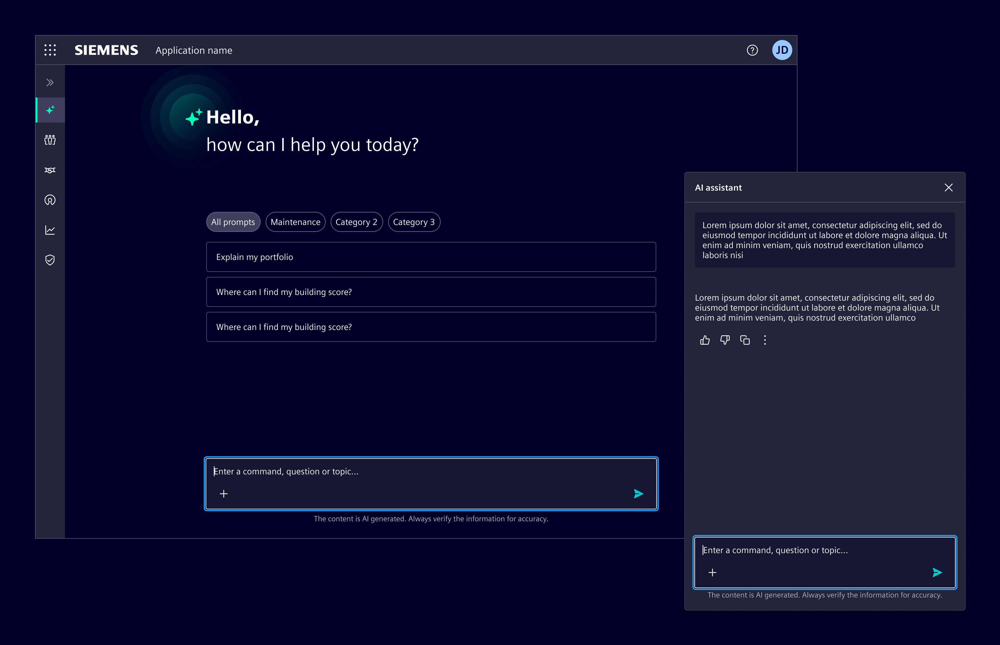
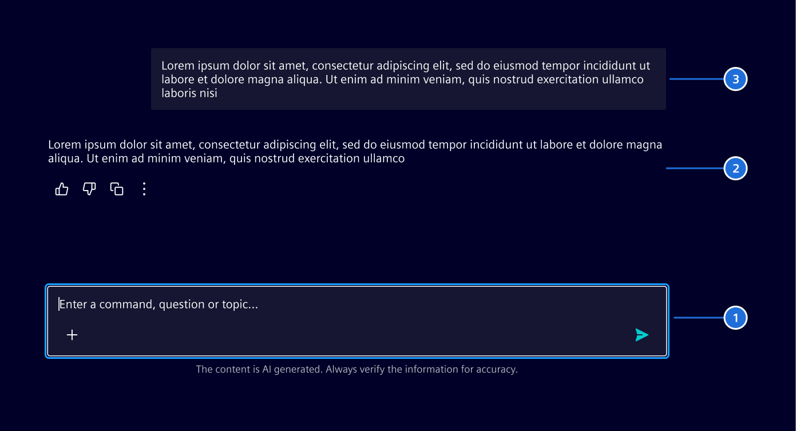
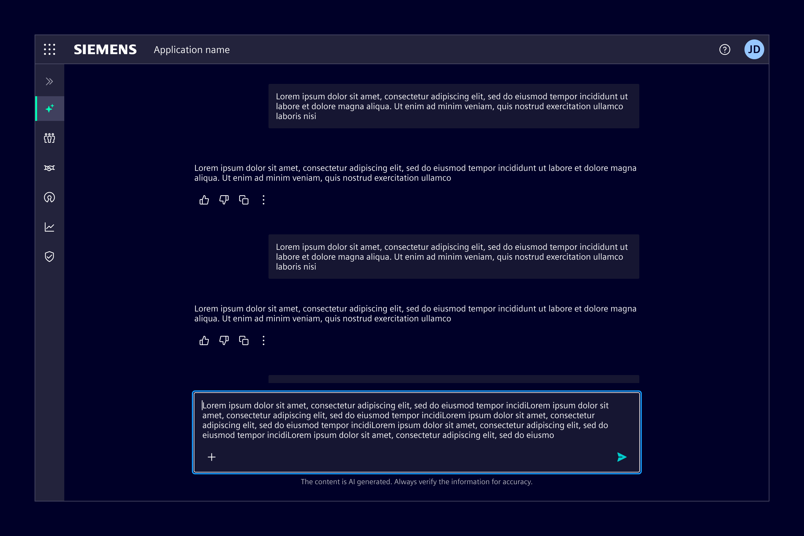
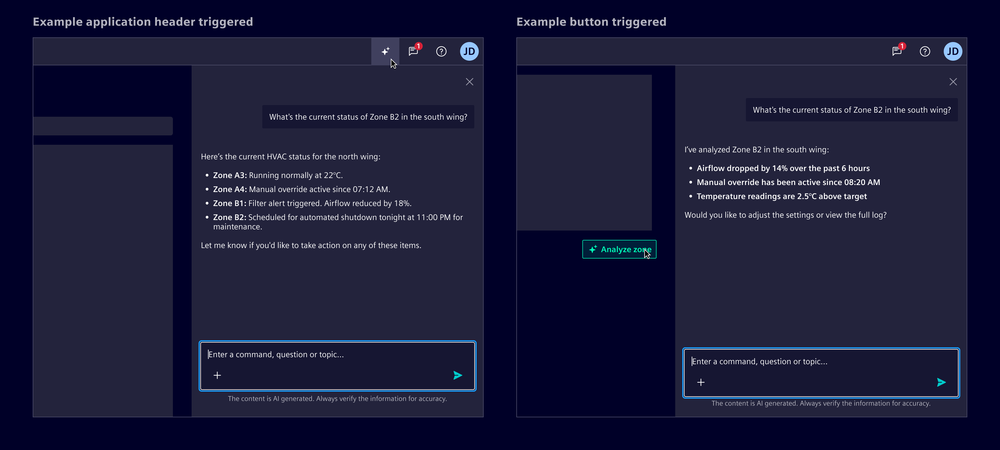
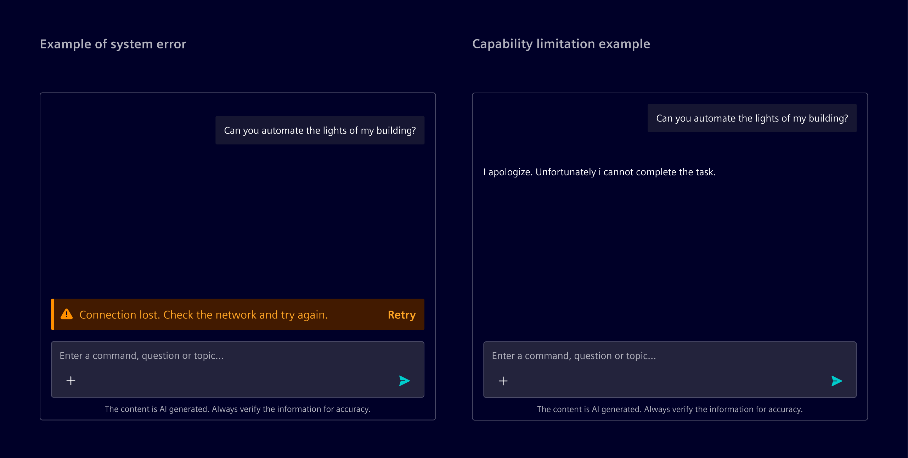
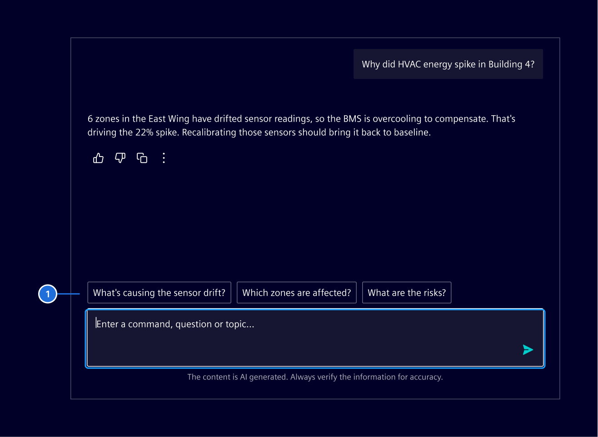

# AI chat

The **AI chat** is a complete conversational interface for AI features.

## Usage ---

AI chat enables users to interact with the product using natural language.

It extends the [chat container](../chat-messages/chat-container.md)
with AI-specific behavior, such as follow-up prompts and the
[activity message](../chat-messages/activity-message.md) for tool calls.



### When to use

- For AI features where users describe tasks in their own words and
  expect structured responses or guidance.
- When natural language input improves the experience compared
  to navigating multiple UI elements.

### Best practices

- Refer to [conversational design](https://ix.siemens.io/docs/guidelines/conversational-design/getting-started) guidelines.
- Always allow users to review, edit, or retry.
- Use [follow-up prompts](../../components/chat-messages/chat-input.md#follow-up-prompts) after AI responses to help users continue the conversation without formulating the next message from scratch.

## Design ---

### Elements



1. [Chat input](../../components/chat-messages/chat-input.md)
2. [Chat message - AI](../../components/chat-messages/chat-message.md)
3. [Chat message - User](../../components/chat-messages/chat-message.md)

### Layout patterns

#### Full page layout

Use it when AI is the main feature.
Typically triggered from a dedicated navigation item, this layout makes AI functionality easily accessible as a primary experience.



#### Side panel layout

Use it when AI supports tasks within the current view.
In this case, the AI appears as an on-demand assistant without disrupting the workflow in a
[side panel](../../components/layout-navigation/side-panel.md).

- When the AI feature is globally accessible, the side panel can be triggered from the
  [application header](../../components/layout-navigation/application-header.md), ensuring consistent entry across all screens.
- For contextual use, place the trigger near the related feature or content.



### Errors and AI limitations

System errors, such as timeouts or backend crashes, occur outside the AI’s reasoning.
These should be represented with [inline notifications](../../components/status-notifications/inline-notification.md),
placed above the input prompt.

When the AI cannot complete a task due to a known limitation, it should respond within the conversation.
These are not treated as errors and do not require a separate notification.



### Follow-up prompts

Follow-up prompts are 2-4 suggested actions based on the AI’s last response.
They guide users toward deeper or related questions.

Show follow-up prompts only after relevant AI responses,
and clear them as soon as the user sends a new message.



> 1. Follow-up prompts

## Code ---

The **si-ai-chat** component provides a complete AI chat interface, it should be inserted into a layout with fixed height, if no fixed height is provided, please set a height in pixels.

<si-docs-component example="si-chat-messages/si-ai-chat" height="750"></si-docs-component>

<si-docs-api component="SiAiChatComponent"></si-docs-api>

Use `type: 'activity'` for tool calls, progress, and reasoning. `input` accepts a string, a list of
short inputs, or a record of labeled inputs. `output` accepts a string. These values are rendered as
activity message parts, while `content` is rendered directly as markdown. Prefer `content` when the
activity does not need separate input and output sections.

Use `type: 'activity-trace'` to group related or nested activity messages. By default, the latest
activity or trace stays expanded until a newer activity or user message is added. Set the container's
`autoExpand` input to change this globally, or set `autoExpand` on a trace, activity, or nested
activity to override it. Use `autoExpandInputs` and `autoExpandOutputs` for part-level overrides;
`autoExpandInputs` also accepts an array of record keys.

The container's `show` input controls which parts are rendered. It accepts `auto`, `inputs`,
`outputs`, or `both`. The default `auto` mode shows inputs when output is empty and otherwise shows
the output.

### Welcome screen

The AI chat container includes a built-in initial welcome screen component that displays when there are no messages. It can be slotted into the **si-chat-container** component. It accepts prompt suggestions as an input.

<si-docs-component example="si-chat-messages/si-ai-welcome-screen" height="600"></si-docs-component>

<si-docs-api component="SiAiWelcomeScreenComponent"></si-docs-api>

#### Prompt suggestions

Prompt suggestions can be provided as either:

- A simple array of suggestions (no categories)
- A record mapping category labels to arrays of suggestions

When using a record, categories are automatically displayed as filter pills.

```typescript
// Simple array (no categories)
promptSuggestions = [
  { text: 'How do I optimize performance?' },
  { text: 'What are best practices?' }
];

// Record with categories
promptSuggestions = {
  'All prompts': [{ text: 'How do I optimize performance?' }, { text: 'What are best practices?' }],
  'Maintenance': [{ text: 'Schedule preventive maintenance' }, { text: 'Track equipment downtime' }]
};
```
