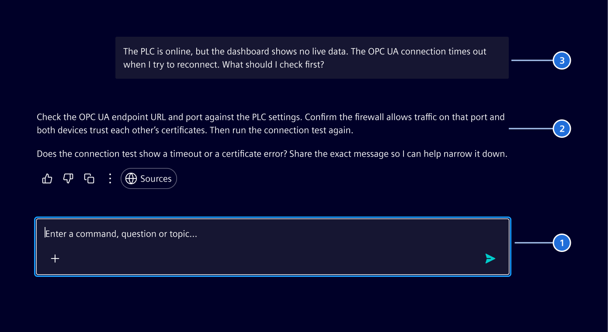
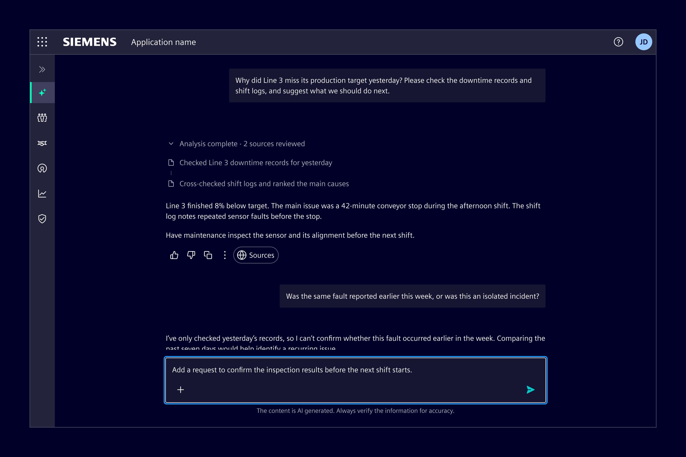
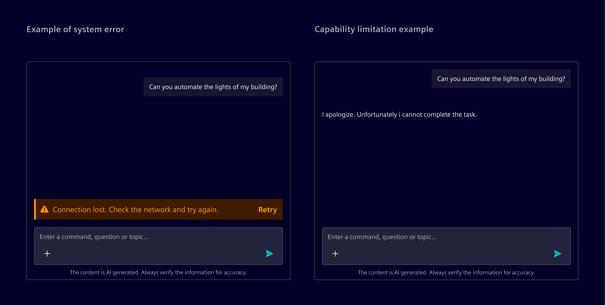
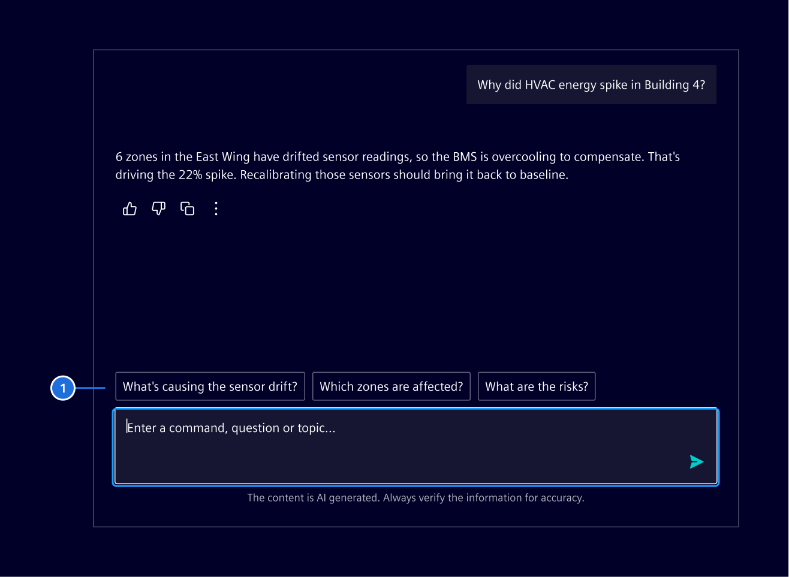

# AI chat

The **AI chat** provides a complete AI chat interface that enables users to interact with AI-powered
features through conversation.

## Usage ---

The AI chat enables users to interact with a product by
submitting requests, asking questions, and receiving responses in natural language.

It uses the [chat container](../chat-messages/chat-container.md)
with AI-specific behavior, such as follow-up prompts and the
[activity message](../chat-messages/activity-message.md) for tool calls.


### When to use

- For AI features where users describe tasks in their own words and
  expect structured responses or guidance.
- When natural language input improves the experience compared
  to navigating multiple UI elements.

### Best practices

- Always allow users to review, edit, or retry.
- Use the [AI welcome screen](../chat-messages/ai-welcome-screen.md) when starting a new conversation
  to introduce the assistant and help users understand how to interact with it.
- Use [follow-up prompts](../../components/chat-messages/chat-input.md#follow-up-prompts) after AI responses
  to help users continue the conversation without formulating the next message from scratch.
- Refer to [AI chat history](../../patterns/ai/ai-chat-history.md) pattern for
  guidelines on displaying and managing previous AI conversations
- Refer to [conversational design](https://ix.siemens.io/docs/guidelines/conversational-design/getting-started) guidelines.

## Design ---

### Elements



1. [Chat input](../../components/chat-messages/chat-input.md)
2. [Chat message - AI](../../components/chat-messages/chat-message.md)
3. [Chat message - User](../../components/chat-messages/chat-message.md)

### Layout patterns

#### Full page layout

Use it when AI is the main feature.
Typically triggered from a dedicated navigation item, this layout makes AI functionality easily accessible as a primary experience.



#### Side panel layout

Use it when AI supports tasks within the current view.
In this case, the AI appears as an on-demand assistant without disrupting the workflow in a
[side panel](../../components/layout-navigation/side-panel.md).

- When the AI feature is globally accessible, the side panel can be triggered from the
  [application header](../../components/layout-navigation/application-header.md), ensuring consistent entry across all screens.
- For contextual use, place the trigger near the related feature or content.


### Errors and AI limitations

System errors, such as timeouts or backend crashes, occur outside the AI’s reasoning.
These should be represented with [inline notifications](../../components/status-notifications/inline-notification.md),
placed above the input prompt.

When the AI cannot complete a task due to a known limitation, it should respond within the conversation.
These are not treated as errors and do not require a separate notification.



### Follow-up prompts

Follow-up prompts are 2-4 suggested actions based on the AI’s last response.
They guide users toward deeper or related questions.

Show follow-up prompts only after relevant AI responses,
and clear them as soon as the user sends a new message.



> 1. Follow-up prompts

## Code ---

`si-ai-chat` is model-driven: pass message data through the `messages` input, and the component
renders the conversation for you. It supports streaming responses, message actions, and activity
traces.

Place `si-ai-chat` in a layout with a fixed height, or set the component's height in pixels if the
layout does not provide one.

<si-docs-component example="si-chat-messages/si-ai-chat" height="750"></si-docs-component>

### Welcome screen

By default, the built-in [AI welcome screen](ai-welcome-screen.md) appears when there are no
messages and `loading` is `false`.

The example starts with a conversation. Use **Clear messages** in the chat input to see the
welcome screen.

Set `[hideWelcomeScreen]="true"` to disable the welcome screen.

```html
<si-ai-chat [messages]="messages()" [hideWelcomeScreen]="true">
  <si-chat-input (send)="onMessageSent($event)" />
</si-ai-chat>
```

### Activity messages and traces

Use `type: 'activity'` for an individual step, such as a tool call or a progress update. Use
`type: 'activity-trace'` to group related steps under one collapsible heading. For design guidance,
see [Activity message](activity-message.md).

#### Choose what to display

Use `content` for a single Markdown description. Use `input` and `output` when the activity needs
to distinguish what went into a step from what it returned. `input` accepts a string, an array of
short labels, or a record that maps labels to text. `output` accepts a string.

The `si-ai-chat` component's `show` input controls which input and output details are visible.
It does not affect `content`.

- `auto` (default): Show the output if it is non-blank; otherwise, show the inputs.
- `inputs`: Show only the inputs, if provided.
- `outputs`: Show only the output, if non-blank.
- `both`: Show inputs and non-blank output, when present.

#### Control automatic expansion

By default, the latest activity or trace opens automatically. A newer activity, trace, or user
message ends that automatic expansion; an AI response alone does not.

- Set `[autoExpand]="false"` on `si-ai-chat` to turn off automatic expansion by default.
- Set `autoExpand` on a trace, activity, or nested activity to override the inherited setting.
- Use `autoExpandInputs` and `autoExpandOutputs` to control expansion of individual details.
  For labeled inputs, pass an array of record keys to `autoExpandInputs` to expand only those inputs.

Setting `[autoExpand]="false"` changes the default, not the overrides. For example, if the latest
activity has visible output, `autoExpandOutputs: true` can still expand it automatically.

[[ api('SiAiChatComponent') ]]

[[ api_types() ]]
