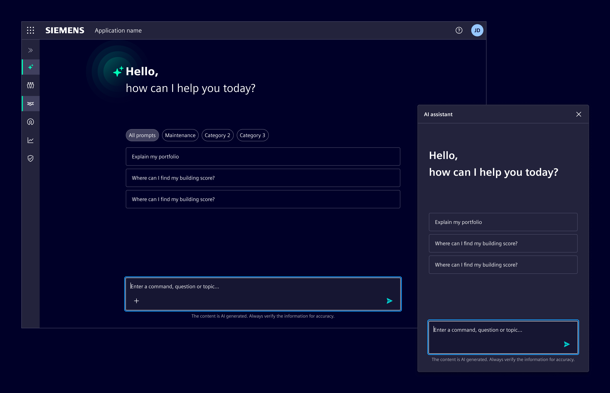
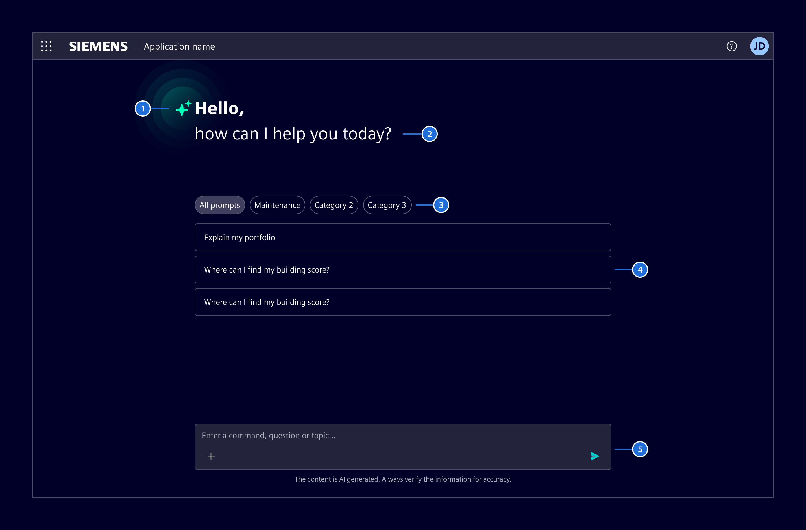

# AI welcome screen

The **AI welcome screen** is the first thing users see when they open an AI chat.
It introduces the AI and offers starting points, so users don't face an empty input without knowing what to ask.

## Usage ---

The AI welcome screen is shown before the first message in an [AI chat container](ai-chat.md).
As soon as the user prompts a message, the welcome screen should disappear.

### When to use

- When starting a new conversation in an AI chat container, before any message is sent.
- To set expectations about what the AI can and can't do.
- To help users get started with relevant prompt suggestions.

### Best practices

- Show only relevant prompt suggestions that reflect common actions or the current context.
- Limit the number of suggestions, and use prompt categories when there are too many to scan.
- Write suggestions as complete prompts users can edit them or send as they are.

## Design ---

### Elements

1. AI icon
1. Salutation: A brief, welcoming message that sets a conversational tone.
1. Prompt categories (optional): When suggestions exceed a manageable number, group them by topic or function using
   [summary chips](../../components/status-notifications/summary-chip.md)
1. Prompt suggestions (optional): Curated prompts or example questions that reflect common or relevant actions.
1. [Chat input](../../components/chat-messages/chat-input.md)

## Code ---

When initially displaying a chat interface use the initial **si-welcome-screen** component that displays when there are no messages. It can be slotted into the **si-chat-container** component. It accepts prompt suggestions as an input.

<si-docs-component example="si-chat-messages/si-ai-welcome-screen" height="600"></si-docs-component>

<si-docs-api component="SiAiWelcomeScreenComponent"></si-docs-api>

<si-docs-types></si-docs-types>
