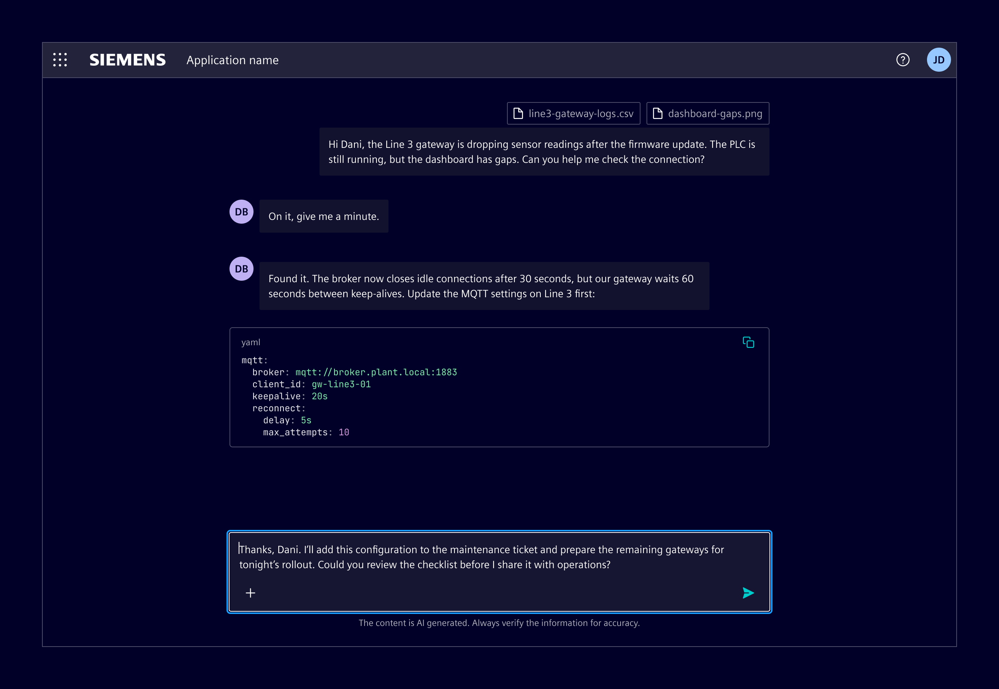
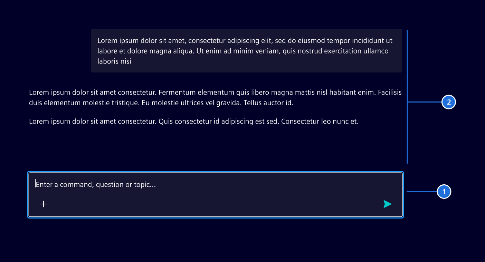
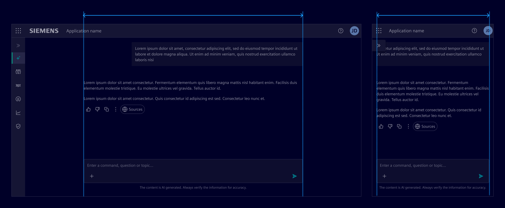

# Chat container

The **chat container** is the foundational layout for building chat experiences.

Use the [AI chat](../chat-messages/ai-chat.md) for standard AI conversations.
It builds on the chat container with predefined AI-specific behaviors.

## Usage ---

The chat container is a flexible wrapper that
provides slots for [chat messages](../chat-messages/chat-message.md),
the [chat input](../chat-messages/chat-input.md), status notifications, and other chat elements.
It handles their placement, sizing, and scrolling.

It's also the base of the [AI chat](../chat-messages/ai-chat.md).

### When to use

- When building a chat interface, such as messaging, support conversations, or assistants.

## Design ---

### Elements

The basic chat container consists of a chat input and a message area.
Additional elements, such as status notifications, can be added depending on the use case.

1. [Chat input](../../components/chat-messages/chat-input.md)
2. [Chat messages](../../components/chat-messages/chat-message.md)

### Layout

The content area has a maximum width of 720px.
It scales fluidly on smaller screens and remains centered on larger ones to maintain readability.

## Code ---

Use this base container with the chat messages to build custom chat message interfaces.

The **si-chat-container** component is a wrapper component, it has slots for
[chat messages](../../components/chat-messages/chat-message.md) and a
[chat input](../../components/chat-messages/chat-input.md).

The slots are:

- default -> chat messages or initial screen (`si-welcome-screen`)
- `si-chat-input/siChatContainerInput (helper directive)` -> For the input (whether default or custom).
- `si-inline-notification` -> Slotted above the input for displaying the status.

<si-docs-component example="si-chat-messages/si-chat-container" height="600"></si-docs-component>

[[ api('SiChatContainerComponent') ]]
