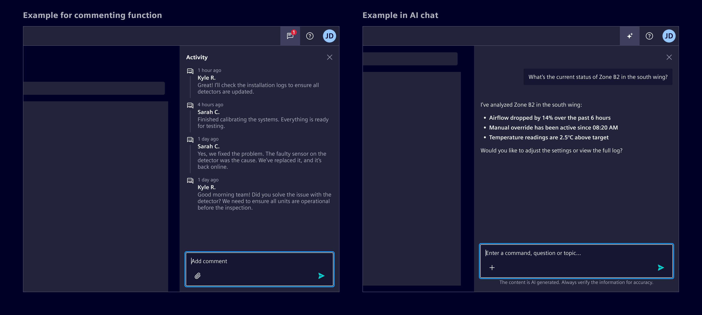
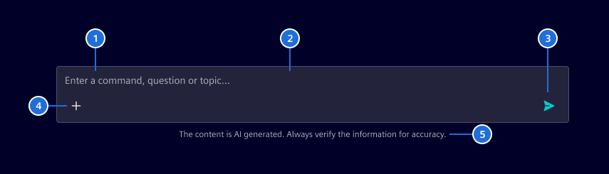
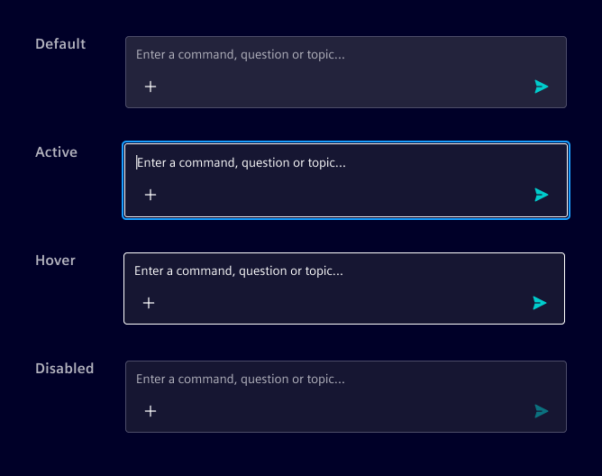
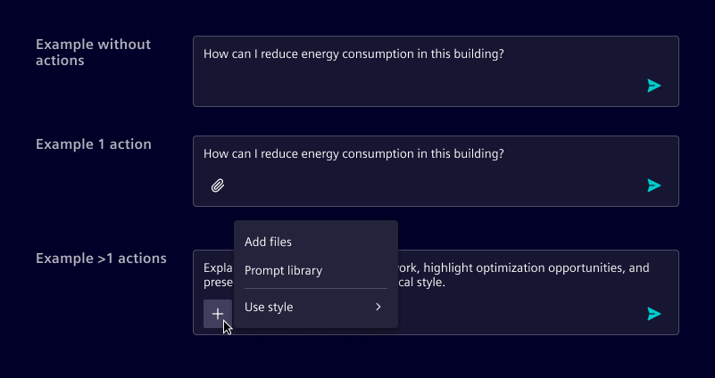
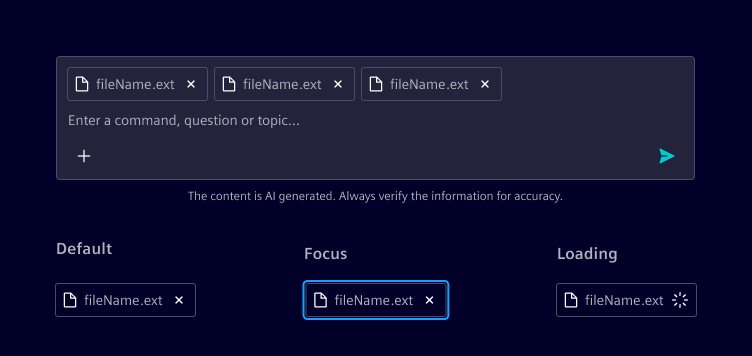

# Chat input

The **chat input** is a text field for composing and submitting messages in conversational interfaces.
It supports both AI-assisted interactions and human-to-human chat.

## Usage ---

The chat input enables users to send messages or comments depending on context:

- User chat: Sends real-time messages in a conversation
- AI chat: Submits queries to a system for response
- Commenting: Adds contextual feedback or notes tied to a specific element



### When to use

- In any interface where users need to communicate or leave feedback.
- When freeform text input is required in chat, messaging, or commenting scenarios.

### Best practices

- Always autofocus the input prompt when the page or chat view is opened.
- Limit input width to 720px for legibility.
- Match placeholder text to context (e.g., “Ask anything”, “Type a message”, “Leave a comment”).
- Disable the send button when input is empty or invalid.
- Add the legal disclaimer when used for AI functions.

## Design ---

### Elements



> 1. Placeholder text, 2. Container, 3. Send button, 4. Actions (optional), 5. Legal disclaimer (only for conversational AI)

### Interaction states



### Actions

When actions are available, they appear directly below the text area
It is recommended to display up to one action inline; any additional actions should be grouped into a menu.



### Attachments

When supported, attachments appear within the input area as part of the composed message,
allowing users to review and remove them before sending.

If multiple attachments are added, they wrap and stack within the input field.



### Overflow behavior

The input field automatically expands as the user types, up to a set maximum height.
Beyond that point, scrolling is enabled within the input.

### Follow-up prompts

Follow-up prompts are suggested next actions displayed as pill buttons above the chat input after an AI response.
They help users continue the conversation without having to formulate the next message from scratch.

- Prompts wrap to multiple lines when labels are long.
- Selecting a prompt inserts its text into the input field so the user can review or edit before sending.
- The prompt list is cleared when the user sends a message.

### Voice input

Voice input is optional and uses a consumer-provided button in the existing action slot.
The reusable `siSpeechInput` directive also works outside chat input. It does not add a
dependency to applications that only import chat components.

In toggle mode, activate the button to start or stop recognition. In push-to-talk mode,
hold the pointer, Space, or Enter to record and release to stop. Escape on the button
cancels the attempt and restores the previous draft. Stopping retains the final transcript;
it does not send a message unless the consumer opts in.

The consumer controls the icon, contextual actions, and chat state. The directive supplies
translated start/stop labels and the pressed state. It preserves button focus, including
when recognition finishes. Consumers can optionally project a provider-independent audio
waveform beside the button without adding waveform behavior to chat or speech input.

## Code ---

<si-docs-component example="si-chat-messages/si-chat-input"></si-docs-component>

### Follow-up prompts

Pass a `string[]` to `followUpPrompts` to display suggested prompts above the input.
When the user clicks a prompt, `followUpPromptSelected` emits its text. Use the event to insert the
text into the input and clear the prompt list.
Clear the list (set to `[]`) on send and repopulate it after each AI response.

```html
<si-chat-input
  [followUpPrompts]="aiResponse?.followUpPrompts ?? []"
  (followUpPromptSelected)="onFollowUpSelected($event)"
  (send)="onSend($event)"
/>
```

### Voice input

<si-docs-component example="si-chat-messages/si-chat-voice-input"></si-docs-component>

Import `SiSpeechInputDirective` from `@siemens/element-ng/speech-input` alongside the chat
and icon components. Recognition uses the browser's `SpeechRecognition` or
`webkitSpeechRecognition` implementation. The browser requests microphone permission on
the first start; unsupported browsers disable the button. Browser support and language
availability vary, and some implementations send audio to the browser vendor's service.
Assess privacy and consent requirements before enabling recognition.

The example overrides `SI_SPEECH_INPUT_RECOGNITION` with an asynchronous simulator,
so it never requests microphone access. Applications normally use the default browser
adapter; the injectable factory also supports other providers and deterministic tests.
Place the button in the `siChatInputEnd` projection slot to keep it next to Submit.

```html
<si-chat-input [(value)]="message" [sending]="sending()" (send)="onSend($event)">
  <button
    type="button"
    class="btn btn-tertiary-ghost btn-icon"
    siChatInputEnd
    siSpeechInput
    #speech="siSpeechInput"
    [(value)]="message"
    [disabled]="sending()"
    continuous
    [silenceTimeout]="2000"
    startLabel="APP.DICTATE"
    (transcript)="onTranscript($event)"
    (listeningChange)="onListeningChange($event)"
    (errorOccurred)="onSpeechError($event)"
  >
    <si-icon [icon]="speech.listening() ? icons.elementStopFilled : icons.elementVoice" />
  </button>
</si-chat-input>
```

`value` is the complete draft, including text present before recognition began. Partial
results replace previous partial results rather than appending duplicates. `transcript`
emits only the current attempt's recognized text. Chat input resizes for external updates.
Do not edit or send the shared draft while recognition is active unless your application
defines how those edits should interact with recognition updates.

`listening()` becomes true synchronously before permission startup and remains true while
final results are pending. `continuous` controls whether the provider continues after an
utterance. `silenceTimeout` stops after silence, including a session with no speech; zero
disables the timer. `lang` supplies a BCP 47 language tag.

#### Audio waveform

Import `SiVoiceWaveformComponent` from `@siemens/element-ng/chat-messages` and place it
before the speech button in the same `siChatInputEnd` slot:

```html
@if (speech.listening()) {
<si-voice-waveform siChatInputEnd [active]="capturing()" [level]="audioLevel()" />
}
```

The waveform is decorative (`aria-hidden="true"`) and occupies a fixed 120 by 16 pixel
viewport. Supply normalized audio levels from 0 to 1; zero represents silence, while
undefined uses simulated speech-like levels. Non-finite values become silence and values
outside the range are clamped. The example uses simulated levels, not microphone audio.

`active` controls sampling independently of the recognition attempt. Keep the waveform
mounted with `active` false while collecting final results to preserve its history, and
remove it when the attempt ends. A new mount starts at the silent baseline. The speech
directive's `listening()` includes permission startup and final-result collection; it
does not indicate that audio is currently being captured. Use your provider's capture
lifecycle for `capturing()`. Reduced motion and Element's disabled-animation policy stop
sampling and movement without discarding existing samples.

#### Auto-send after speaking

Auto-send remains an application decision. The following sends after recognition ends:

```html
<si-chat-input #chat [(value)]="message" (send)="onSend($event)">
  <button
    type="button"
    class="btn btn-tertiary-ghost btn-icon"
    siChatInputEnd
    siSpeechInput
    #speech="siSpeechInput"
    [(value)]="message"
    (listeningChange)="$event || speech.completionReason() === 'completed' && message() && chat.sendCurrent()"
  >
    <si-icon [icon]="speech.listening() ? icons.elementStopFilled : icons.elementVoice" />
  </button>
</si-chat-input>
```

`sendCurrent()` respects chat's disabled, sending, and empty-draft rules. It does not
trigger the interrupt action. Completion is emitted after shared draft bindings have rendered,
so auto-send receives the final transcript. `listeningChange(false)` also occurs on cancellation or
failure. Check `completionReason()` to distinguish `completed`, `cancelled`, and `error`
before auto-sending. The reason resets to undefined at the start of each attempt.

#### Push-to-talk and standalone use

The same directive can update any signal-backed text field, without a chat component:

```html
<button
  type="button"
  class="btn btn-tertiary-ghost btn-icon"
  siSpeechInput
  mode="push-to-talk"
  [(value)]="message"
>
  <si-icon [icon]="icons.elementVoice" />
</button>
```

Releasing during permission startup requests a stop as soon as recognition starts.
Repeated activation never creates concurrent attempts. `stop()` keeps final results;
`cancel()` restores the draft saved at startup. Disabling or destroying the directive
aborts recognition, clears timers, and invalidates late callbacks.

#### Permission denied

```html
<si-chat-input [(value)]="message" (send)="onSend($event)">
  <button
    type="button"
    class="btn btn-tertiary-ghost btn-icon"
    siChatInputEnd
    siSpeechInput
    [(value)]="message"
    noPermissionHint
    (errorOccurred)="onSpeechError($event)"
  >
    <si-icon [icon]="icons.elementVoice" />
  </button>
</si-chat-input>
```

`noPermissionHint` shows a focusable recovery popover for `not-allowed` and
`service-not-allowed` errors. Customize its text with `noPermissionLabel`. The microphone
remains retryable after permission is restored; `permissionDenied()` exposes the last
denied attempt. The application may also show an accessible error or set the directive's
`disabled` input independently of typing and sending. Other failures emit their Web Speech
API error code and restore the draft. `startLabel` and `stopLabel` accept translatable strings.

<si-docs-api component="SiChatInputComponent"></si-docs-api>

<si-docs-api directive="SiSpeechInputDirective"></si-docs-api>

<si-docs-api component="SiVoiceWaveformComponent"></si-docs-api>

<si-docs-types></si-docs-types>
