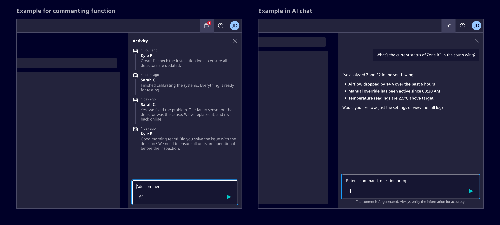
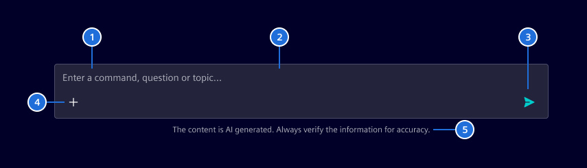
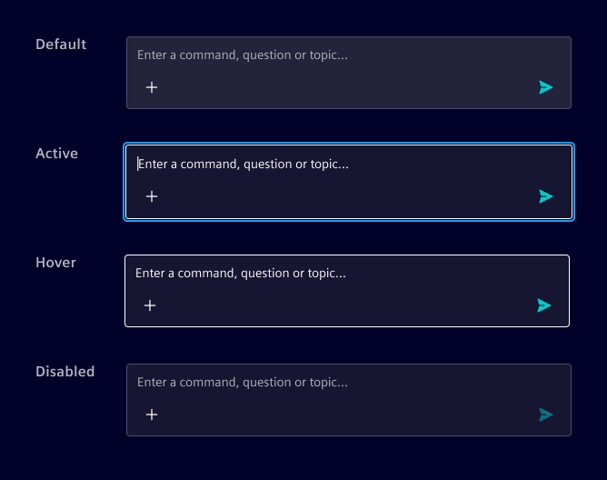
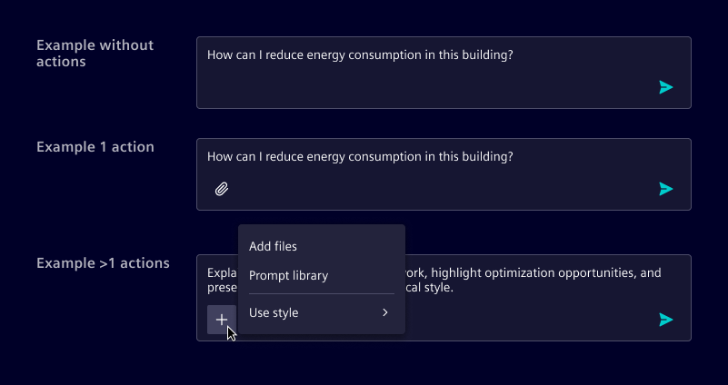
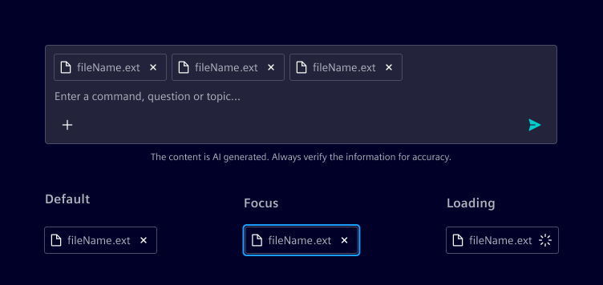

# Chat input

The **chat input** is a text field for composing and submitting messages in conversational interfaces.
It supports both AI-assisted interactions and human-to-human chat.

## Usage ---

The chat input enables users to send messages or comments depending on context:

- User chat: Sends real-time messages in a conversation
- AI chat: Submits queries to a system for response
- Commenting: Adds contextual feedback or notes tied to a specific element



### When to use

- In any interface where users need to communicate or leave feedback.
- When freeform text input is required in chat, messaging, or commenting scenarios.

### Best practices

- Always autofocus the input prompt when the page or chat view is opened.
- Limit input width to 720px for legibility.
- Match placeholder text to context (e.g., “Ask anything”, “Type a message”, “Leave a comment”).
- Disable the send button when input is empty or invalid.
- Add the legal disclaimer when used for AI functions.

## Design ---

### Elements



> 1. Placeholder text, 2. Container, 3. Send button, 4. Actions (optional), 5. Legal disclaimer (only for conversational AI)

### Interaction states



### Actions

When actions are available, they appear directly below the text area
It is recommended to display up to one action inline; any additional actions should be grouped into a menu.



### Attachments

When supported, attachments appear within the input area as part of the composed message,
allowing users to review and remove them before sending.

If multiple attachments are added, they wrap and stack within the input field.



### Overflow behavior

The input field automatically expands as the user types, up to a set maximum height.
Beyond that point, scrolling is enabled within the input.

### Follow-up prompts

Follow-up prompts are suggested next actions displayed as pill buttons above the chat input after an AI response.
They help users continue the conversation without having to formulate the next message from scratch.

- Prompts wrap to multiple lines when labels are long.
- Selecting a prompt inserts its text into the input field so the user can review or edit before sending.
- The prompt list is cleared when the user sends a message.

## Code ---

<si-docs-component example="si-chat-messages/si-chat-input"></si-docs-component>

### Model selection

Supply `models` as `SelectItem<string>[]` and bind the active model ID with `[(selectedModel)]`.
Options support a label, an optional description and a disabled state. The selector appears before
Send and switches to an icon-only trigger when the toolbar cannot fit the active model name.
Enable optional search with `modelSelectionHasFilter` and supply footer actions or submenus through
`modelSelectionActions`, using the existing `MenuItem` API.

Search is disabled by default and is most useful for long model lists. Descriptions appear only when
provided on the options. The example starts with both features off and provides controls to enable
them independently.

Footer items retain the standard menu callback and checked-state behavior. Activating a footer item
closes the selector, including links and items in submenus; opening a submenu keeps it open.

The product owns the options, initial selection and action handlers. Selection only updates the
bound ID; it does not send a message or configure an AI client. Read the selected ID in the product's
send handler. Use `modelSelectionDisabled` to lock selection independently of message composition.

### Follow-up prompts

Pass a `string[]` to `followUpPrompts` to display suggested prompts above the input.
When the user clicks a prompt, `followUpPromptSelected` emits its text. Use the event to insert the
text into the input and clear the prompt list.
Clear the list (set to `[]`) on send and repopulate it after each AI response.

```html
<si-chat-input
  [followUpPrompts]="aiResponse?.followUpPrompts ?? []"
  (followUpPromptSelected)="onFollowUpSelected($event)"
  (send)="onSend($event)"
/>
```

<si-docs-api component="SiChatInputComponent"></si-docs-api>

<si-docs-types></si-docs-types>
