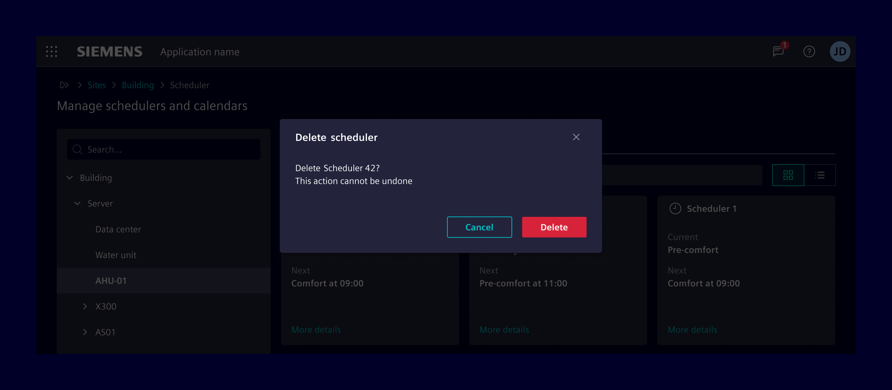
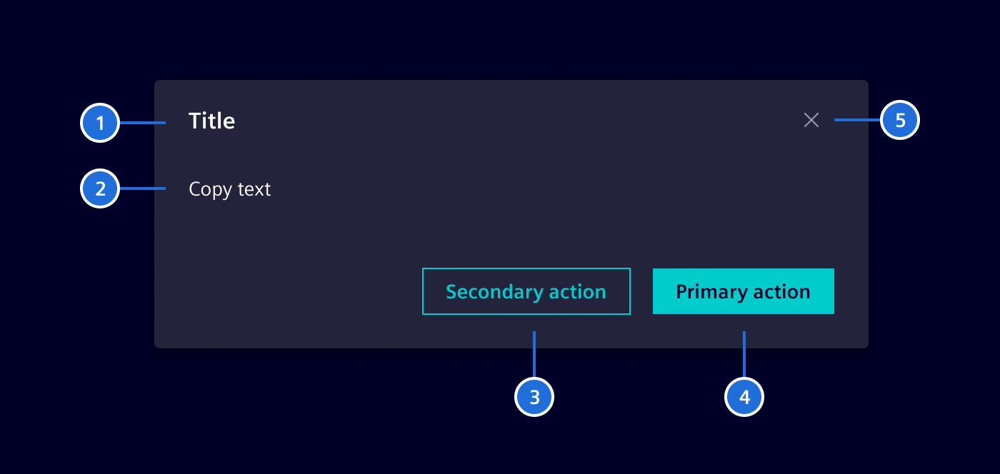
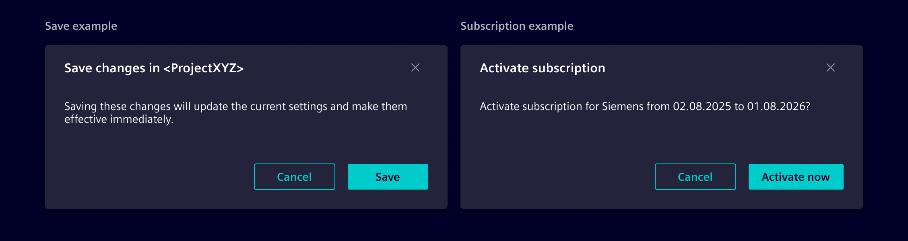
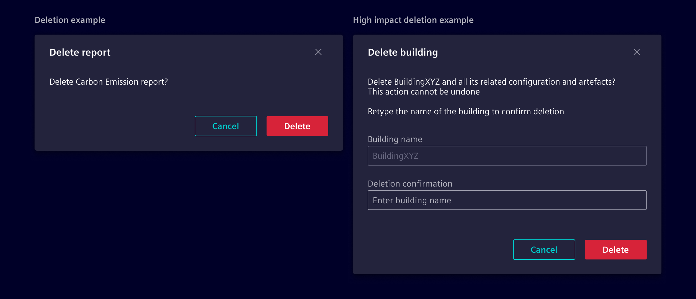

# Modals

Modals are flexible dialog prompts which offer minimal required functionality
and smart defaults. They block the parent window and force users to interact
with the modal itself before allowing to continue the workflow.

## Usage ---



### When to use

- Use modals for guided interactions or showing additional details.
- Use it to interrupt a flow and to catch the user’s full attention.
- Use it to prompt a user to enter information crucial to continuing a process.

### Best practices

- Use button texts which represent their intended action (e.g. use `Delete`
  instead of `Yes` on a delete confirmation dialog).
- Be mindful **when** to show the modal to avoid interrupting the user flow.
- Modals must always be used in combination with [backdrop](../../patterns/backdrop.md)
  to provide visual focus on the active modal content.
- Don't use it for complex decision making that requires additional sources of
  information unavailable in the current context.
- Don't use it for nonessential information that is unrelated to the current
  user flow.

## Design ---

### Elements



> 1. Title, 2. Content, 3. Secondary action (optional), 4. Primary action, 5. Cancel

### Modal sizes

Modals are available in standard widths to accommodate different content types and density:

- **Small (300px)**: Best for simple alerts, short prompts, or compact single-action confirmations.
- **Medium / Default (500px)**: The standard modal width for general transactional tasks and confirmations.
- **Large (800px)**: Suitable for complex forms, multi-column inputs, or data tables.
- **Extra large (1140px)**: Used for data-dense views or wizards.
- **Full-screen**: Takes up the entire viewport on all screens or below specific breakpoints for focused, immersive workflows.

### Common modal types

Modals serve various purposes depending on the scenario. Common examples include:

- **Transactional modals**  
  Used to collect or confirm user inputs, such as completing a form or setting
  preferences.

- **Confirmation modals**  
  Ensure users explicitly approve an action, like saving or submitting data.

  

- **Deletion modals**  
  They are used when the action cannot be undone or the data is hard to recreate.
  For high-impact deletions (e.g., deleting a site with months of work), explicit
  confirmation is required, with safeguards like typing the object’s name or
  enforcing a 4-eyes principle. Low-impact deletions, where data is easy to
  recreate, don’t require a modal.

  

## Code ---

Modals support various content structures, sizes, and behaviors to organize information effectively. Choose the appropriate pattern based on your workflow needs.

Below are examples of what’s supported. Consumers can display modals programmatically
using the [SiModalService](#generic-modals) or use [predefined modal dialogs](#predefined-modal-dialogs).

### Generic modals

To display a modal dialog in any component, follow these steps:

- Import and inject the `SiModalService` in your component.
- Use the `show` method of `SiModalService` to display the modal. This method
  takes either a `TemplateRef` or a component you want to display in the modal.
- Pass configuration options like `class` to customize sizing, scrolling, or positioning.

```ts
import { Component, inject, TemplateRef, viewChild } from '@angular/core';
import { ModalRef, SiModalService } from '@siemens/element-ng/modal';

@Component({
  template: `
    <button type="button" class="btn btn-secondary" (click)="openModal()">Open modal</button>

    <ng-template #sampleModal let-modalRef="modalRef">
      <div class="modal-header">
        <h4 class="modal-title" id="sample-modal-title">Modal title</h4>
        <button
          type="button"
          class="btn btn-circle btn-tertiary-ghost element-cancel"
          aria-label="Close modal"
          (click)="modalRef.hide('cancel')"
        ></button>
      </div>
      <div class="modal-body">
        <p>This is the modal body.</p>
      </div>
      <div class="modal-footer">
        <button type="button" class="btn btn-secondary" (click)="modalRef.hide('close')">
          Close
        </button>
        <button type="button" class="btn btn-primary" (click)="modalRef.hide('save')">
          Save
        </button>
      </div>
    </ng-template>
  `
})
export class SampleComponent {
  private modalService = inject(SiModalService);
  private modal = viewChild.required<TemplateRef<unknown>>('sampleModal');
  private modalRef?: ModalRef<unknown>;

  openModal(): void {
    this.modalRef = this.modalService.show(this.modal(), {
      class: 'modal-dialog-centered',
      ariaLabelledBy: 'sample-modal-title'
    });
  }
}
```

<si-docs-component example="si-modals/si-modal-service" height="450"></si-docs-component>

### Modal content

When displaying modals with `SiModalService`, the outer dialog container, backdrop, and surface are automatically managed by the service. Consumers only need to structure the template or component content placed inside the dialog:

- **Header (optional)**: Apply `.modal-header` for the title bar containing `.modal-title`, an optional status icon, and a dismiss button
- **Body (required)**: Apply `.modal-body` for the main content area with standardized padding and spacing
- **Footer (optional)**: Apply `.modal-footer` for action buttons, right-aligned with standardized spacing

```html
<ng-template #sampleModal let-modalRef="modalRef">
  <div class="modal-header">
    <h4 class="modal-title" id="sample-modal-title">Modal title</h4>
    <button
      type="button"
      class="btn btn-circle btn-tertiary-ghost element-cancel"
      aria-label="Close modal"
      (click)="modalRef.hide('cancel')"
    ></button>
  </div>
  <div class="modal-body">
    <p>Modal body content goes here.</p>
  </div>
  <div class="modal-footer">
    <button type="button" class="btn btn-secondary" (click)="modalRef.hide('close')">
      Close
    </button>
    <button type="button" class="btn btn-primary" (click)="modalRef.hide('save')">
      Save changes
    </button>
  </div>
</ng-template>
```

**Available content classes:**

| Class           | Element                   | Purpose          | Usage                                                                            |
| --------------- | ------------------------- | ---------------- | -------------------------------------------------------------------------------- |
| `.modal-header` | `<div>`                   | Header container | Top bar placing title, optional status icon, and dismiss button on opposite ends |
| `.modal-title`  | `<h1>` - `<h6>`, `<span>` | Primary heading  | Heading for the modal dialog with standardized typography and line height        |
| `.modal-body`   | `<div>`                   | Content area     | Main container for dialog content, forms, and scrollable data                    |
| `.modal-footer` | `<div>`                   | Action bar       | Container for action buttons with right alignment and standardized spacing       |

**Best practices:**

- Always associate `.modal-title` with the dialog by setting `ariaLabelledBy` in modal options
- Include a dismiss button in `.modal-header` with an accessible `aria-label`
- If an icon is placed in `.modal-header`, add the `.icon` class to ensure standard sizing and margin before `.modal-title`
- Place primary actions on the right and cancel or dismiss actions to the left in `.modal-footer`

### Modal sizes

Modals support several width options to accommodate different content requirements. By default, a modal dialog has a maximum width of 500px on viewports above the small (`sm`) breakpoint.

To change the width, pass a size modifier class in the `class` property of `ModalOptions` when calling `SiModalService.show()`:

**Available size classes:**

| Class               | Max width (`sm` and up) | Purpose             | Usage                                                               |
| ------------------- | ----------------------- | ------------------- | ------------------------------------------------------------------- |
| `.modal-sm`         | 300px                   | Small dialogs       | Simple alerts, short prompts, or compact confirmation dialogs       |
| _(default)_         | 500px                   | Standard dialogs    | General transactional tasks, settings, and standard confirmations   |
| `.modal-lg`         | 800px                   | Large dialogs       | Multi-step forms, complex inputs, or data tables with multiple cols |
| `.modal-xl`         | 1140px                  | Extra large dialogs | Data-heavy views, wizards, or advanced configuration panels         |
| `.modal-fullscreen` | 100vw / 100%            | Fullscreen dialogs  | Full-viewport coverage for immersive workflows or mobile layouts    |

**Responsive full-screen variants:**

Responsive full-screen classes make the dialog full-screen only below a specific breakpoint, returning to standard dialog sizing on larger viewports:

| Class                        | Full-screen breakpoint           |
| ---------------------------- | -------------------------------- |
| `.modal-fullscreen-sm-down`  | Full-screen below 576px (`sm`)   |
| `.modal-fullscreen-md-down`  | Full-screen below 768px (`md`)   |
| `.modal-fullscreen-lg-down`  | Full-screen below 992px (`lg`)   |
| `.modal-fullscreen-xl-down`  | Full-screen below 1200px (`xl`)  |
| `.modal-fullscreen-xxl-down` | Full-screen below 1400px (`xxl`) |

```ts
this.modalService.show(template, {
  class: 'modal-lg'
});
```

### Centered modals

By default, modals are aligned near the top of the viewport. Pass `.modal-dialog-centered` in the `class` property of `ModalOptions` to vertically center the modal in the viewport:

```ts
this.modalService.show(template, {
  class: 'modal-dialog-centered'
});
```

### Scrollable modals

When modal content exceeds the viewport height, the default behavior scrolls the entire modal container. To keep the header and footer fixed in place while making only the body content scrollable, pass `.modal-dialog-scrollable` in the `class` property of `ModalOptions`.

This sets `overflow-y: auto` on `.modal-body` and limits the dialog height to the viewport, ensuring that dialog titles and action buttons remain visible at all times:

```ts
this.modalService.show(template, {
  class: 'modal-dialog-scrollable'
});
```

### Combining modifier classes

Modifier classes can be combined as needed. For example, combine `.modal-lg`, `.modal-dialog-centered`, and `.modal-dialog-scrollable` for a large, vertically centered dialog with internal body scrolling:

```ts
this.modalService.show(template, {
  class: 'modal-lg modal-dialog-centered modal-dialog-scrollable'
});
```

### Predefined modal dialogs

This section describes the general usage of the element modals.

<si-docs-component example="si-modals/si-modal-dialogs" height="450"></si-docs-component>

#### Action dialog

Element provides the service `SiActionDialogService`.
The service provides a method to display the modal dialogs for each dialog type.
They offer mandatory and optional parameters to configure the dialogs and
return an `Observable` with the user's result.

##### Alert dialog

Use the alert dialog to request the attention of the user to a certain
event, which is so severe, that the normal use of the application is
interrupted and the user needs to confirm to this alert. The result
is just `confirm`, which indicates that the users took notice of
the dialog.

##### Confirmation dialog

Use the confirmation dialog to request a yes-no or agree-disagree confirm-decline
answer from the user. Default button labels are yes and no. Closing the dialog
with the close button returns a decline.

##### Delete confirmation dialog

Use the delete confirmation dialog to request user confirmation before
deleting any object.

##### Edit-discard dialog (unsaved data)

Use the edit-discard dialog when leaving or canceling a data form
that was modified. User results are `Save`, `Discard`, or `Cancel`.

- `Save`: User still wants to save the changes. Save them and navigate away.
- `Discard`: Discard the changes and navigate away.
- `Cancel`: User is unsure and cancel leaving the form. Close the dialog and let
  the user further edit the form.

#### Column selection dialog

Use the `SiColumnSelectionDialogService` if you need a dialog to configure the
column setup of a table.

<si-docs-api injectable="SiModalService"></si-docs-api>

<si-docs-api injectable="SiActionDialogService"></si-docs-api>

<si-docs-api injectable="SiColumnSelectionDialogService"></si-docs-api>

<si-docs-types></si-docs-types>
