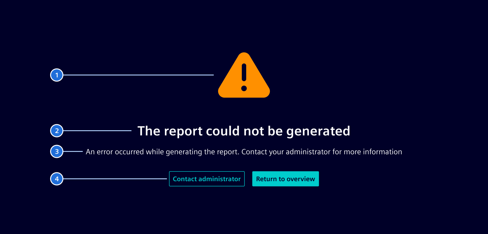

# Info page

**Info pages** are used when a page-level situation interrupts the normal route and users need a clear explanation and a way forward. 

## Usage ---

Info pages are helpful to display missing routes, unavailable resources, authorization boundaries and server-side failures,
as well as other standalone informational pages that need the same focused layout.

They can use **icons or illustrations** to support the message's meaning and make it easier to understand.


### When to use

- Use it to show an error that blocks the user, such as a broken link or a page that can't load 
  (e.g., [HTTP error pages](../../patterns/http-error-pages.md)).
- Use it to prompt a required action before the user can continue, such as joining a company or accepting an invitation.
- Don't use it for errors that can be fixed inline. Show a message next to the field or action instead.

### Best practices

- Focus the page on one situation and one clear next step
- Don't use info pages for transient failures while users remain in their current workflow.
- Don't use info pages for an ordinary lack of content, use an [empty state](../status-notifications/empty-state.md) instead.

## Design ---

### Elements



1. **Image**: The image can be an icon or illustration that is semantically associated with the current view. 
2. **Title**: A short and concise title to explain the topic.
4. **Description (optional)**: Brief supporting text that explains the situation or the next step.
5. **Actions (optional)**: Actions that help users recover, navigate away or request support.

## Code ---

### Usage

```ts
import { RouterModule } from '@angular/router';
import { SiInfoPageComponent } from '@siemens/element-ng/info-page';

@Component({
  imports: [SiInfoPageComponent, ..],
})
```

Use the `si-info-page` component on a page of
your application and set the input properties as needed. All input strings are sent to
the translate pipe by the component.

### Default info page

The component comes with an integrated icon. Configure the icon, icon color, set the text
as needed and provide a link to leave the page again.

<si-docs-component example="si-info-page/si-info-page" height="350"></si-docs-component>

### Stacked icon

Use the `&lt;si-icon/&gt;` component and add the `.si-info-image` CSS class to configure a
stacked icon according to your needs. Any elements with the `.si-info-image` class will replace
the internal icon component using content projection.

Use content projection and add the CSS class `.si-info-actions` to the surrounding element
to inject `Actions`.

<si-docs-component example="si-info-page/si-info-page-stacked-icon" height="350"></si-docs-component>

### Illustrations

Use the `&lt;img/&gt;` element with Angular's `NgOptimizedImage` directive and add the `.si-info-image`
CSS class to change the info page image to an illustration. Provide the image using `ngSrc` and set
its `width` and `height` up front, preserving the source image's aspect ratio to prevent distortion.

<si-docs-component example="si-info-page/si-info-page-illustration" height="650"></si-docs-component>

<si-docs-api component="SiInfoPageComponent"></si-docs-api>

<si-docs-types></si-docs-types>
