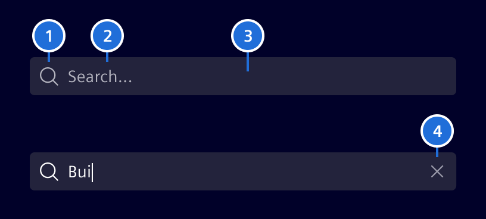
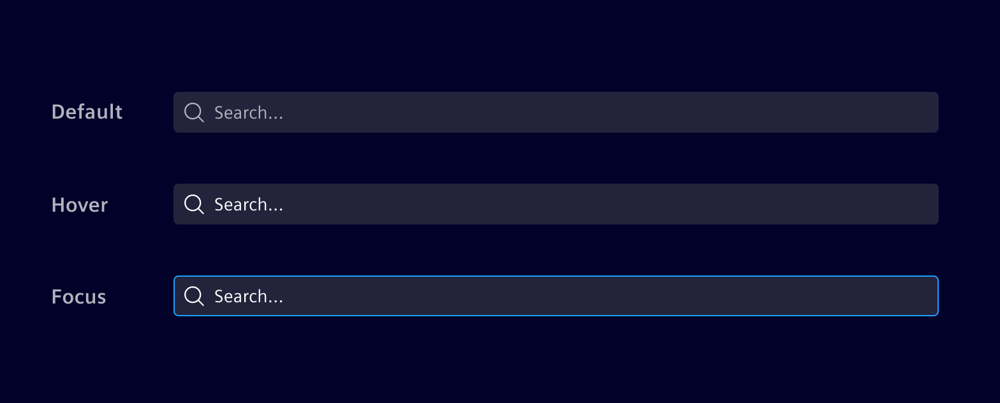

# Search bar

The **search bar** allows users to quickly find content using free text.

## Usage ---


### When to use

- Use it if a full text search is required.

### Best practices

- Ignore punctuation within searches.
- Combine with the [typeahead behavior](../sorting-filtering/typeahead.md) to
  assist users when searching.
- Don't use wildcard encoding for more complex search statements.
- Consider adding other search capabilities according to project needs (e.g. use
  quotes to search for exact matches).
- The placement of the _Search Bar_ depends on the layout of the viewport. See
  the [list-details](../layout-navigation/list-details.md)
  for placement guidance. See [data table](../lists-tables-trees/overview.md)
  for search placement within a data table.

## Design ---

### Elements



> 1. Search icon, 2. Content, 3. Container, 4. Clear button

### Interaction states

The search bar container color should always be in contrast with its
surrounding background. Use `background-2` or `background-1` accordingly.



## Code ---

### Search with signal forms

Use `si-search-field` with Angular signal forms to add a search icon and a clear
button around a native input. Set `type="search"`, add the
`form-control search-bar-input` classes and bind the input using `[formField]`.

```ts
import { Component, debounced, signal } from '@angular/core';
import { form, FormField } from '@angular/forms/signals';
import { provideSiFormFieldConfig } from '@siemens/element-ng/form';
import { SiSearchFieldComponent } from '@siemens/element-ng/search-field';

@Component({
  imports: [FormField, SiSearchFieldComponent],
  providers: [provideSiFormFieldConfig()],
  template: `
    <si-search-field>
      <input
        type="search"
        class="form-control search-bar-input"
        aria-label="Search products"
        placeholder="Search products…"
        [formField]="searchField"
      />
    </si-search-field>
    <p>Search term: {{ debouncedSearchTerm.value() }}</p>
  `
})
export class SearchComponent {
  readonly searchTerm = signal('');
  readonly searchField = form(this.searchTerm);
  readonly debouncedSearchTerm = debounced(this.searchTerm, 400);
}
```

Set the placeholder and accessible label directly on the input. The placeholder
is empty when omitted.

The clear button appears when the input contains text and is editable. Clicking
it clears the field and returns focus to the input. Disabled and readonly states
are configured through the signal form.

Use Angular's `debounced()` to delay search updates while keeping the input
responsive. The example uses a delay of 400 ms.

Use `provideSiFormFieldConfig()` to enable invalid-state styling. Provide any
validation messages and associated ARIA attributes in the application.

<si-docs-component example="si-search-field/si-search-field"></si-docs-component>

<si-docs-api component="SiSearchFieldComponent"></si-docs-api>

### Search bar with reactive or template-driven forms

It has a callback, which can be seen in example as call to `getData()`, which
triggers every time a user has interaction with search bar. It also includes the
actual search term.

Input `[debounceTime]` is the wait time in `ms` for the search bar to notify
changes after a user stops typing. (Type: `number`, Default value: `400`).

Input `[showIcon]` defines if a search icon is displayed (false by default).

### Usage

```ts
import { SiSearchBarComponent } from '@siemens/element-ng/search-bar';

@Component({
  imports: [SiSearchBarComponent, ...]
})
```

<si-docs-component example="si-search-bar/si-search-bar"></si-docs-component>

### Search Bar - Input Value

Modify input value by setting `value`.

<si-docs-component example="si-search-bar/si-search-bar-value"></si-docs-component>

<si-docs-api component="SiSearchBarComponent"></si-docs-api>

<si-docs-types></si-docs-types>
